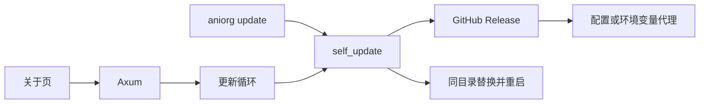

# 技术方案

## 架构

命令行和 daemon 共用 `src/self_update.rs`。daemon 在原来的 HTTP 服务旁边加一条程序更新循环：启动约数秒后查 GitHub Release，之后按 `app_update_interval`（默认 `6h`，最短按 5 分钟）。

发布构建在编译时读取 `ANIORG_GIT_SHA`。Release、master 发布和 nightly 工作流把 `github.sha` 放进这个环境变量。本地 `cargo run` 没有该变量，视为没有提交号的开发构建。

## 技术栈

沿用 Rust、axum 和 reqwest + rustls。reqwest 增加 `socks`。新增 `sha2`、`flate2`、`tar`、`zip` 和 `libc`，只为校验、解包和在 Unix 上忽略挂起信号，不引入自更新框架。

默认更新源是 `https://api.github.com/repos/ModerRAS/anime-organizer/releases/latest`。`app_update_feed` 可改成另一份相同 JSON；只允许 `https`，或本机回环上的 `http`。

## 怎么判定更新

Release 的 `tag_name` 必须是 `vMAJOR.MINOR.PATCH` 或 `vMAJOR.MINOR.PATCH+BUILD`。`+BUILD` 是 master 工作流写进版本号的构建号。资产名按顺序接受：

- `aniorg-<版本>-<目标>.tar.gz` 或 `.zip`
- `aniorg-<标签>-<目标>.tar.gz` 或 `.zip`
- `aniorg-<目标>.tar.gz` 或 `.zip`

旁边必须有同名 `.sha256`。Windows 优先 zip，其他系统优先 tar.gz。

| 本机 | 远端 | 结果 |
| --- | --- | --- |
| 版本或构建号更低 | 已识别的稳定标签 | 更新 |
| 版本和构建号相同，双方提交号不同 | 发布构建 | 更新 |
| 版本和构建号相同，提交号相同或远端没有提交号 | 任意 | 不更新 |
| 没有提交号 | 版本和构建号不更高 | 不更新 |
| 版本或构建号更高 | 任意 | 不降级 |

目标三元组按编译时的系统、架构和 musl/gnu 选择，和现有发布矩阵一致。压缩包只解出 `aniorg` 或 `aniorg.exe`，以及和它同一目录的 DLL；拒绝 `..` 和绝对路径，并核对 ELF、PE 或 Mach-O 魔数。新文件先放到可执行文件旁边的 `.new`，再由当前进程拉起替换进程：等原进程退出、改名、用原来的参数重启。Windows 上先把正在运行的文件改名为 `.old`。替换进程忽略 `SIGHUP`。

Cargo `target/debug` 与 `target/release` 下的程序只提示、不自动替换。关于页的「更新并重启」和 `aniorg update` 仍会替换。

整理任务进行时不重启。自动检查遇到正在运行的任务会等一分钟再看。

## 代理

| 配置 | 行为 |
| --- | --- |
| 空 | `ALL_PROXY`、`all_proxy`、`HTTPS_PROXY`、`https_proxy`、`HTTP_PROXY`、`http_proxy` 里第一个非空值 |
| `off` | 直连，忽略环境变量 |
| `http` / `https` / `socks5` / `socks5h` URL | 使用该代理 |

程序更新的查询和下载共用这一选择。回环地址不走代理。页面上的代理字符串会去掉用户名和密码。自定义源只允许回到该源的主机，或回环地址。默认源的包只允许 `github.com`、`*.github.com`、`*.githubusercontent.com` 的 `https`。`ANIORG_GITHUB_TOKEN` 或 `GITHUB_TOKEN` 只附加到 `api.github.com`。

## 接口与配置

`update.json` 放在和 `daemon.db` 相同的数据目录：

| 字段 | 默认 | 含义 |
| --- | --- | --- |
| `app_update_interval` | `6h` | 程序更新间隔，`off` 关闭 |
| `auto_apply_app_update` | `true` | 发现新构建后自动替换 |
| `app_update_feed` | 空 | 空则用 GitHub 最新 Release |
| `proxy` | 空 | 空则跟随环境变量，`off` 强制直连 |

`GET /api/v1/status` 增加 `app_update`。`PUT /api/v1/app-update/settings` 保存配置。`POST /api/v1/app-update/check` 只查询。`POST /api/v1/app-update/apply` 查询并在有新构建时替换重启。没有 `update.json` 时用默认值，不改写已有的 `daemon.db`。

隐藏参数 `--replace-from`、`--replace-to`、`--wait-for-parent`、`--restart-arg`、`--from-self-update` 只给替换进程用。`--replace-to` 必须就是当前可执行文件，`--replace-from` 必须是它旁边的 `.new`。

## 测试策略

纯函数覆盖版本和构建号判定、资产选择、SHA256 文本、代理选择与脱敏、更新源地址和压缩包路径检查。本地 HTTP 服务提供一份假 Release，核对会下载对应压缩包、校验 SHA256，并只解出可执行文件和同目录 DLL。一个只回答绝对 URL 请求的本地代理用来证明客户端确实走了代理。不在测试里替换正在运行的 `cargo test` 二进制。

## 安全性

daemon 仍然只监听回环。代理凭据不进页面。程序包地址按来源限制主机。替换参数不能指向任意路径。压缩包里的其他文件不落盘。不降级，也不在校验失败时覆盖当前程序。
