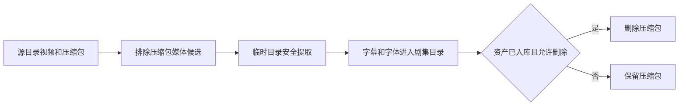

# 技术方案

## 架构

提取逻辑放在 `src/archive_assets.rs`，本地整理和远端整理都调用它。解压只使用 `zip`、`sevenz-rust2` 0.10 和 `rar-codec`，不调用 shell。

CloudDrive2 的 proto 只有未挂接的 `UnmountArchiveResult`，没有服务端解压 RPC。远端路径是：下载到临时文件、本地提取、上传白名单文件。

## 安全边界

- 扩展名白名单：`ass ssa srt sup sub idx vtt ttf otf ttc`。
- 任何路径分段里出现 `exe dll scr bat cmd ps1 js vbs lnk url` 等危险扩展名都跳过该条目。
- 绝对路径、`..`、NUL、符号链接、硬链接、加密项和 7z 反项拒绝整个压缩包，并清空本次输出目录。
- 默认上限：10000 个条目、单文件 128 MiB、总量 1 GiB、压缩比 100。压缩包本体超过 2 GiB 直接拒绝。
- 写出使用 `create_new`，创建目录前拒绝跟随符号链接，写完后确认目标仍是临时目录内的普通文件。

## 配对

压缩包只作用于同一父目录的视频。字幕先按现有词干前缀规则匹配，再用 ` - 集数` 加标题重叠兜底。字体在压缩包文件名自带集数时只给那一集，否则给同目录全部剧集。字幕平铺在视频旁边；字体保留 `fonts/Name.ttf` 这类相对路径。

临时文件会被多集共用，因此放入目标时只复制或硬链接，不移动临时副本。硬链接失败则复制。

## 接口

- 本地：`--delete-extracted-archives`、`--scan-extracted-archives`。两者都不能和 `--daemon` 同时出现。旧任务缺少这两个字段时按 `false` 反序列化。
- 远端：不新增订阅列。仅当 `move_sources && remove_empty_dirs` 且该压缩包已有资产上传成功时，在 `finalize_planned_root` 删除远程压缩包。
- Defender：仅 Windows 调用 `MpCmdRun.exe -Scan -ScanType 3 -File <临时目录>`。其他平台警告一次并保留资产。

## 测试

- 提取单元测试覆盖 zip/7z/rar 白名单、zip slip、符号链接、压缩炸弹、条目上限。
- 本地整理测试确认字幕和字体进入剧集目录、默认保留压缩包、显式删除，以及恶意 zip 不落盘。
- 远端整理测试确认字幕 zip 上传到剧集目录并在移动加空目录清理时删除压缩包，恶意 zip 不产生上传。
